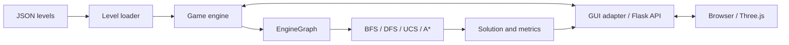

# Bloxorz — Puzzle Solving with AI Search

Play Bloxorz in 3D, find solutions, and explore how BFS, DFS, UCS, and A* search the game's state space.

<!-- TODO: Confirm the official project title, course/program, and institution. -->

## Introduction

Bloxorz challenges players to roll a 1×1×2 block into a goal hole, standing upright to win. Gaps, fragile tiles, bridges, and switches that split the block make this more than a conventional pathfinding problem on a grid.

This project models each game configuration as a state and applies search algorithms to find a sequence of actions leading to the goal. It connects game rules, solvers, and an interactive interface while supporting comparisons of solution length, expanded states, search time, and memory usage.

## Features

- Play in a browser with a 3D interface built with Three.js.
- Choose from 26 playable levels, from `level_01` to `level_26`.
- Navigate fragile tiles, bridges, soft/heavy switches, and mechanics for splitting and merging two smaller cubes.
- Run BFS, DFS, UCS, or A*; watch solution replays and stop a search or replay.
- View search time, peak memory usage, expanded states, and solution length.
- Explore tests for game rules, level loading, solvers, and GUI integration, plus benchmarking and plotting scripts.

## Architecture and Methods

The backend uses **Python and Flask**; the frontend uses **HTML, CSS, JavaScript, and Three.js**. Levels are stored as JSON, and experimental results are stored as CSV. The plotting script uses pandas, Matplotlib, and seaborn.



Each state includes the block's position and orientation, a bitmask of bridge states, and information about the two cubes when the block is split. The engine generates legal moves, activates switches, handles splitting and merging, and determines win/loss outcomes.

| Algorithm | Search strategy |
| --- | --- |
| BFS | Explores states layer by layer to find a solution with the fewest actions. |
| DFS | Uses a stack to explore deeply while tracking visited states; does not guarantee an optimal solution. |
| UCS | Prioritizes states with the lowest accumulated path cost. |
| A* | Prioritizes states using `f = g + h`, combining accumulated cost with an estimate of the remaining cost. |

The GUI uses `EngineGraph` so that all solvers share the game engine's rules and costs. The repository also includes `MazeGraph`, an independent backend with its own rules and costs; use the same backend when comparing algorithms. IDS is also implemented in `solvers/dfs.py`; the GUI's DFS button currently runs DFS.

See the [engine interface](Source/docs/INTERFACE.md) and [solver conventions](Source/solvers/Convention.md) for API details. Some notes in these supporting documents may be out of sync with the current implementation.

## Project Structure

```text
AI_Project1_Bloxorz/
├── README.md                       # Project overview and quick start
├── NOTE.md                         # Initial problem analysis
└── Source/
    ├── main.py                     # Flask application entry point
    ├── requirements.txt            # Application dependency: Flask
    ├── README.md                   # Instructions for the Source directory
    ├── game/                       # States, JSON loader, and game rules
    ├── solvers/                    # BFS, DFS/IDS, UCS, and A*
    │   └── utils/                  # Graph adapters, search algorithms, solver base
    ├── gui/
    │   ├── server.py               # Flask routes and API
    │   ├── engine_adapter.py       # Data conversion between engine and GUI
    │   ├── level_loader.py         # Loader for the GUI/mock format
    │   ├── mock_engine.py          # Mock engine for GUI development
    │   ├── templates/index.html    # Game page
    │   └── static/                 # 3D rendering JavaScript and CSS
    ├── levels/                     # JSON levels and groups g1–g4
    │   ├── edge_cases/             # Unsolvable test level
    │   └── reference/              # Upstream data, attribution, and license
    ├── tests/                      # Unit tests, integration tests, and fixtures
    ├── utils/measure.py            # Solver timing and memory measurement
    ├── experiments/
    │   ├── benchmark.py            # Solver comparison script
    │   ├── results.csv             # Recorded results
    │   ├── plot_results.py         # Plot generation from CSV
    │   └── benchmark_charts.png    # Saved charts
    └── docs/INTERFACE.md           # Interfaces between components
```

## Installation

The code uses Python 3.10+ syntax and requires a browser with WebGL support. The browser needs an Internet connection to load Three.js and fonts from CDNs.

<!-- TODO: Document the officially tested Python versions and operating systems. -->

From the repository root:

```bash
cd Source
python -m venv .venv
```

Activate the virtual environment on **Windows PowerShell**:

```powershell
.\.venv\Scripts\Activate.ps1
```

Or on **Linux/macOS**:

```bash
source .venv/bin/activate
```

Install the dependency and start the application:

```bash
python -m pip install -r requirements.txt
python main.py
```

Open **http://127.0.0.1:5000** to play. Press `Ctrl+C` in the terminal to stop the server. If your system uses `python3`, replace `python` with `python3` in the commands above.

## Usage

### Play and Watch Solutions

1. Select a level from **Chapter Selection**.
2. Use the arrow keys or `W`, `A`, `S`, and `D` to roll the block. Press `Space` to switch the active cube when the block is split.
3. Select **BFS**, **DFS**, **UCS**, or **A* Search** to solve the level from its initial state and automatically replay the solution.
4. View results in **Search Metrics**. Use **Stop Solver** to stop or **Reset Board** to restart.

### Call a Solver from Python

Start Python from the `Source` directory and enter the following example. The input is a JSON-style grid where `S` is the start, `G` is the goal, and `.` is a floor tile:

```python
from game import Level
from solvers.bfs import solve

level = Level.from_dict({
    "name": "demo",
    "grid": ["S...", "....", "...G"],
})
path, stats = solve(level)

print([step.name for step in path] if path is not None else None)
print(stats["solution_length"])
```

Sample output, matching an existing test case in the repository:

```text
['RIGHT', 'DOWN', 'DOWN', 'RIGHT']
4
```

To use an existing level, replace the `level` construction with `load_level("levels/level_01.json")`, importing `load_level` from `game`.

### Tests and Experiments

Run the test suite from `Source`:

```bash
python -m unittest discover -s tests -t . -v
```

Run the benchmark; this overwrites `experiments/results.csv`:

```bash
python experiments/benchmark.py
```

To regenerate the charts, install the separate analysis dependencies and run the plotting script from `experiments`. These libraries are not currently listed in `requirements.txt`:

```bash
python -m pip install pandas matplotlib seaborn
cd experiments
python plot_results.py
```

## Experimental Results

The following values are taken directly from the recorded results for `level_24.json` in [results.csv](Source/experiments/results.csv). They have not been measured again:

| Algorithm | Recorded time (seconds) | Expanded states | Steps |
| --- | ---: | ---: | ---: |
| BFS | 0.4899 | 5892 | 58 |
| DFS | 0.2691 | 2264 | 1314 |
| UCS | 0.5027 | 5624 | 59 |
| A* | 0.5562 | 4857 | 59 |

In this example, BFS produces the fewest steps, while DFS returns a longer path. UCS optimizes the engine's cost function, so its solution length can differ from BFS.

**Data limitations:** the benchmark script measures elapsed time around the solver call, including its separate memory-measurement run. The CSV memory column records `0` because the script reads attribute names that differ from the solver result's `peak_memory_kb`; this column cannot support conclusions about memory usage. These results are insufficient to establish a general performance ranking.

<!-- TODO: Add hardware specifications, environment versions, repetition counts, and standardized benchmark results. -->
<!-- TODO: Add a verified screenshot or demo video. -->

## Contributors and Acknowledgments

<!-- TODO: Add each team member's name and role, or author information for an individual project. -->
<!-- TODO: Add the instructor/supervisor, if applicable. -->

Thanks to Jacob Coughenour / nostabyte for the upstream level data credited in [SOURCE.txt](Source/levels/reference/SOURCE.txt). Source details, revision information, and data conversions are documented in `Source/levels/reference/`.

## License

The repository currently has no root-level license file specifying a license for the complete codebase.

<!-- TODO: Confirm the license for the team's source code and add a root-level LICENSE file. -->

The third-party level data in `Source/levels/reference/` and the conversions/adaptations described in `SOURCE.txt` retain the upstream **GNU GPL v3** license. See the [included license](Source/levels/reference/LICENSE). This does not declare a license for the entire repository.
